# dsh-git-management

**English** | [繁體中文](README.md) | [简体中文](README.zh-CN.md)

**Manage Git right from the DSH sidebar**: stage, commit, branch, sync, browse history and open pull requests without leaving the chat.

> Written for **vibe coders**: you don't need to memorise git commands — follow the recipes below and click.
> Want to see it first? Scroll to the screenshots (the slots are reserved; images are coming).

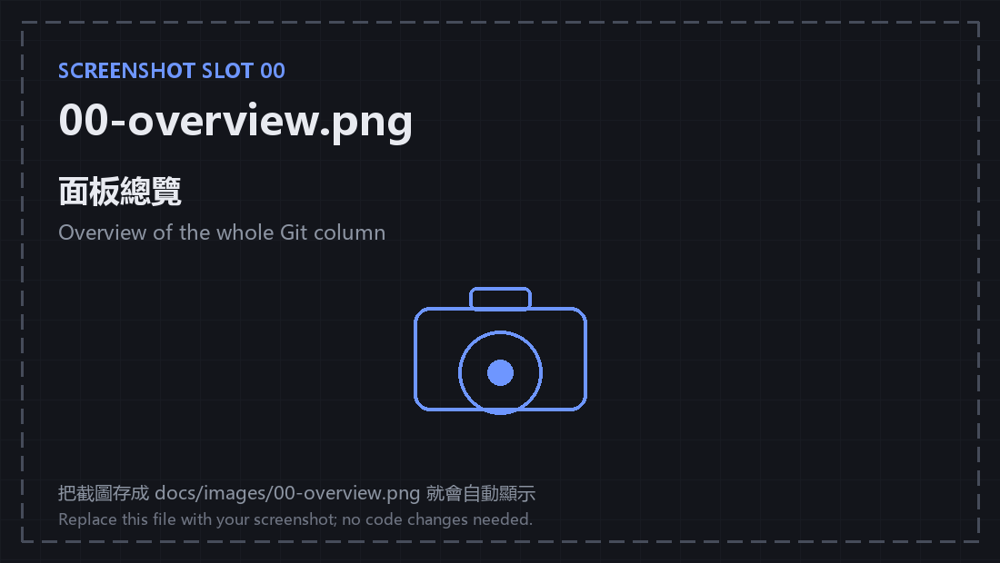

> 📸 **Screenshot slot 00**: the whole right-hand Git column. See [Screenshot checklist](#screenshot-checklist) at the bottom.

---

## What is this?

- **A DSH plugin**: it adds a "源代码管理" (Source Control) tab to the right sidebar, modelled on Cursor / VS Code's Source Control view.
- **It drives your system `git`**: what you see here is exactly what `git status` shows in a terminal. No embedded Git, no hidden state — the panel and your terminal never disagree.
- **The panel is just the entry point**: file diffs, per-commit diffs, worktrees and GitHub PRs all open as tabs in the same column, so the conversation is never covered.

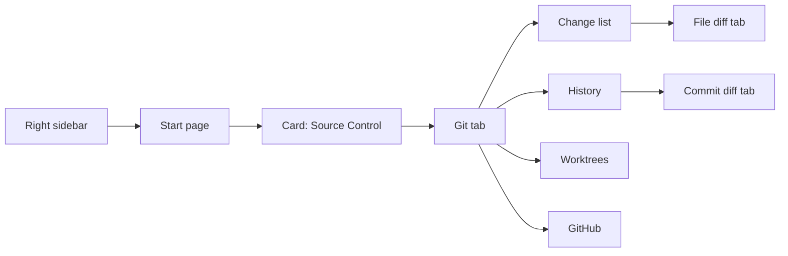

---

## Quick start

1. Open a **session** first (the right sidebar is session-scoped; without one there is no column).
2. In the right sidebar, go to **Start** and find the third card, **源代码管理**.
3. Click it: a Git tab appears and the current workspace's repository is selected for you.

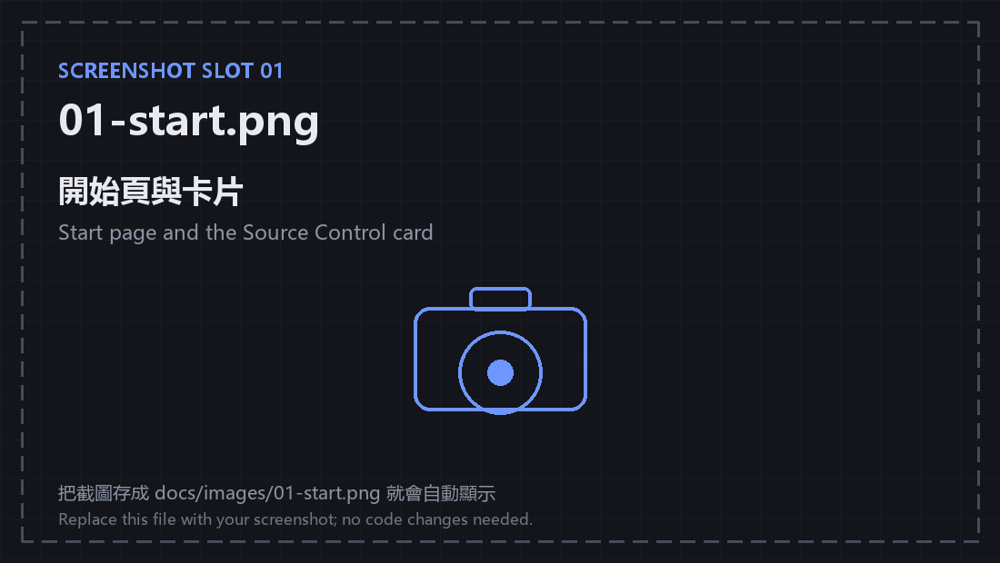

> 📸 **Screenshot slot 01**: the Start page, with the third card fully in frame.

Don't see the panel? Jump to [Troubleshooting](#troubleshooting).

---

## Interface map

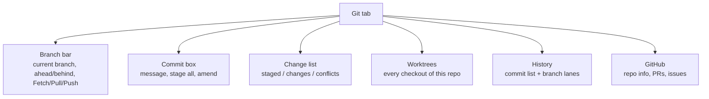

| Area | One-liner |
| --- | --- |
| Branch bar | Where you are, how far from the remote, one-click sync |
| Commit box | Write a message, press commit |
| Change list | Which files changed; click one to see its diff |
| Worktrees | Other folders of the same repo (parallel Agent work) |
| History | What happened; click a row to see that commit |
| GitHub | PRs and issues without leaving the app |

---

## What you can do

### Commit (the everyday thing)

- Hover a file in **Changes** → `＋` stage, `↺` discard, `🗑` delete an untracked file.
- Type a message → `Ctrl+Enter` or press **Commit**.
- **Stage all** takes everything at once; tick **Amend last commit** to amend (the message is pre-filled).
- While conflicts are unresolved the commit button is disabled and says why.

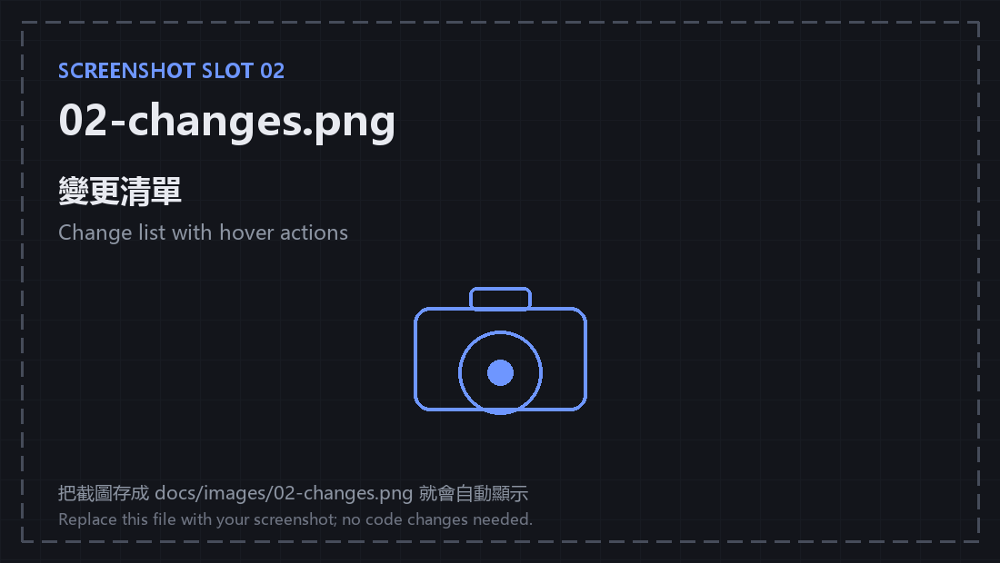

> 📸 **Screenshot slot 02**: the change list with one row hovered so the actions show.

### See a file's diff

- Click a file → a **File diff** tab opens: both gutters, unified/split, previous/next file, `Esc` to close.
- The tab header has **Stage** and **Discard**, so reviewing doesn't send you back to the list.
- Conflicted files say "unresolved conflicts" instead of drawing wrong line numbers.

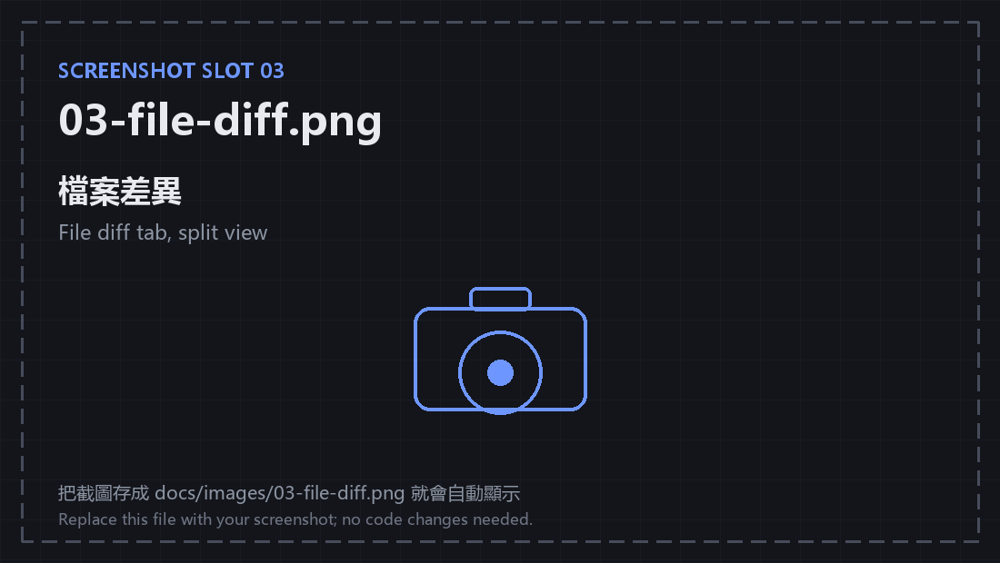

> 📸 **Screenshot slot 03**: the file diff tab in split mode.

### See what one commit changed

- Click any row in **History** → a new **Commit diff** tab opens.
- One block per file, stacked vertically; only the changed hunks are drawn (no whole-file text).
- Renames show `← old path`; binaries get a badge; merges are diffed against the first parent.
- Every click is its **own tab**, so two commits can be read side by side.

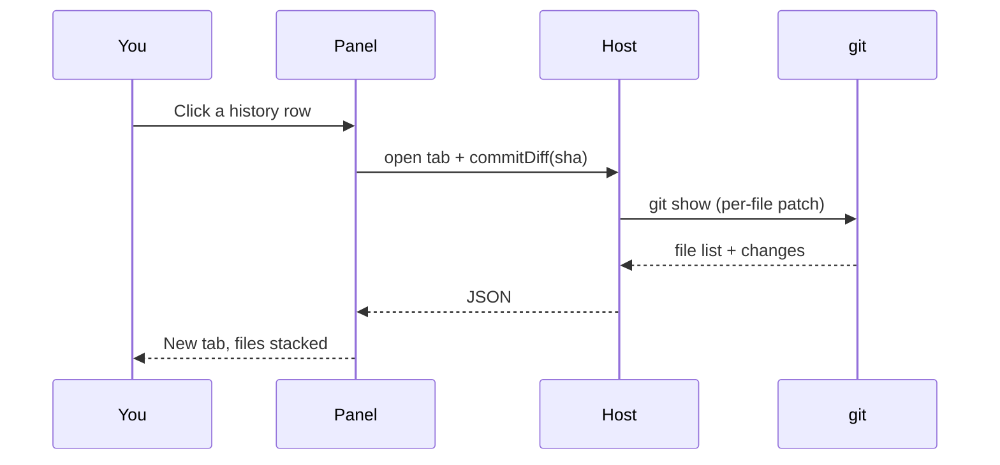

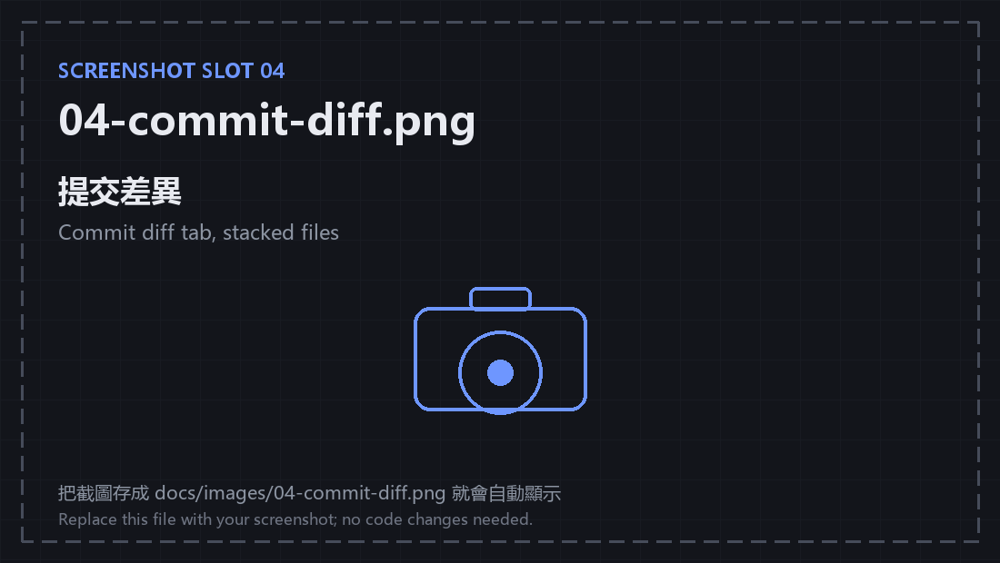

> 📸 **Screenshot slot 04**: the commit diff tab, ideally a commit touching 2–4 files.

### History and branch lanes

- The commit list on the left; an SVG lane rail on the right. Merges bend outwards and every branch is on the same graph.
- Ref badges use colour **and** an icon for "checked out / other local / remote / tag".
- Hover a commit for sha, author, time, message and `N files +X −Y`.
- Ten commits by default, expandable to forty.


> 📸 **Screenshot slot 05**: the history card, ideally a repo with a merge.

### Worktrees (parallel Agent work)

- Lists every checkout of the repo, including the ones DSH creates under `.agents/worktrees/*`.
- Each row shows branch, path, dirty count and a `主` (main) marker; switch the panel to it, open it as a DSH workspace, remove it, or prune.


> 📸 **Screenshot slot 06**: the worktree section with the main checkout plus at least one worktree.

### GitHub

- Detects the origin (ssh/https, GitHub Enterprise included).
- Stars / forks / open issues, pull request list, issue list, and a one-click "new PR" from the current branch.
- The token lives in this browser only; pushing uses your machine's own git credentials.

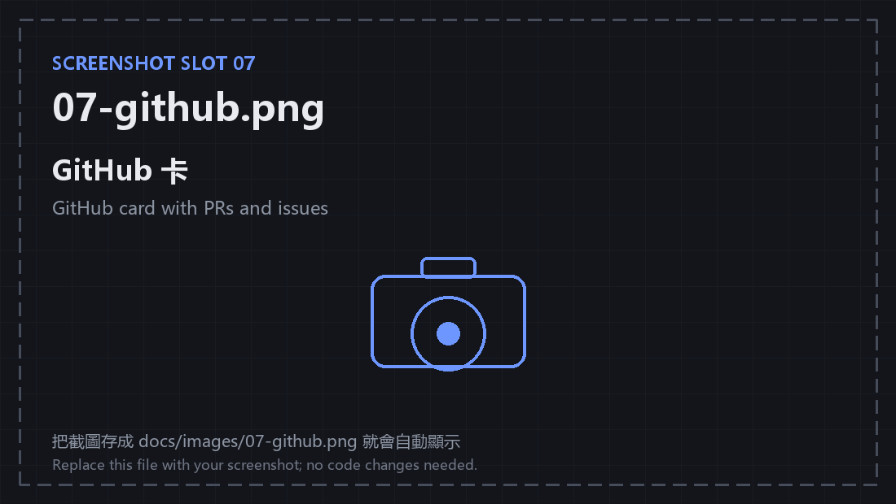

> 📸 **Screenshot slot 07**: the GitHub card, after connecting a token.

### Small extras

- A workspace switcher that remembers your last choice.
- `git init` for a folder that isn't a repository yet.
- Background polling reads only `status`, every 8 seconds, without clearing an error you just saw.
- Error and success notices stick to the top while you scroll.

---

## Recipes

### 1. I finished coding and want to commit

1. Right sidebar → **源代码管理** → **Changes**.
2. Hover a file → `＋` stage (or press **Stage all**).
3. Write a message → **Commit**.
4. To publish, press **Push** in the branch bar (the first push sets the upstream).

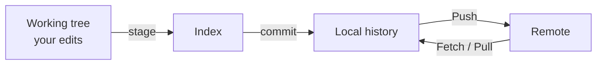

### 2. I want to see what a commit changed

1. Scroll to **History**.
2. Click the row → a **Commit diff** tab opens.
3. With many files, fold file headers or press **Collapse all**.

### 3. I want to switch branches / sync

1. Click the branch name in the branch bar → pick a branch.
2. `Fetch` checks the remote; `Pull` fast-forwards; `Push` publishes.
3. `↑2 ↓1` means two ahead, one behind.

### 4. I want an Agent to work in parallel (worktree)

1. In **Worktrees**, press `＋` and type a name (e.g. `fix-ui`).
2. It is created at `.agents/worktrees/fix-ui` on branch `worktree-fix-ui`.
3. Press **Open** to make it another DSH workspace; the Agent works there and your main tree stays untouched.

### 5. I want to open a pull request

1. Push the branch first.
2. In the **GitHub** card press **New PR**, then fill in title / description / base branch.
3. Or press **Open on GitHub** and do it on the web.

---

## Screenshot checklist

Save the images under `docs/images/` with the names below — the README already points at them, **no code changes needed**.
Suggested: dark theme, 800–1200px wide, PNG. Blur tokens and private repository names before uploading.

| File | Where to capture | What must be in frame | Tip |
| --- | --- | --- | --- |
| `00-overview.png` | The whole right column with the Git tab open | Branch bar, commit box, change list, history | 360–420px wide |
| `01-start.png` | Right column → Start page | The third card "源代码管理" with the two cards above/below | Keep the card fully in frame |
| `02-changes.png` | Change list, one row hovered | Group headers, `+N −N`, hover actions | At least three changes (edit + new file) |
| `03-file-diff.png` | File diff tab in split mode | Both gutters, red/green, header buttons | Pick a file with real additions/removals |
| `04-commit-diff.png` | Commit diff tab | 2–4 file blocks, headers, hunks | A rename or binary makes it richer |
| `05-history.png` | History card | Commit rows, ref badges, lane rail | A repo with a merge looks best |
| `06-worktree.png` | Worktree section | Main worktree plus at least one more, `主` marker | Create a demo worktree first |
| `07-github.png` | GitHub card | Repo name, stars, PR / issue lists | Connect the token first |

---

## Troubleshooting

| Symptom | Cause | Fix |
| --- | --- | --- |
| No "源代码管理" card in the sidebar | No session, or the plugin hasn't loaded | Open a session; press `Ctrl+R` to reload |
| `unknown action: commitDiff` | The page is new but the **Host process is old** | Fully quit DSH Desktop (menu/tray) and relaunch — `Ctrl+R` is not enough |
| Edits don't show up | The panel only polls `status` every 8s | Press refresh, or focus the window |
| A branch's commits are missing | History only reads local refs | `Fetch` first |
| Push fails | No git credentials on this machine | Run `git push` once in a terminal so Credential Manager stores them |
| Blank / broken panel | The client bundle is stale or broken | `npm run build`, then `Ctrl+R` |

---

## Glossary (for people new to git)

| Term | Plain words |
| --- | --- |
| Working tree | The files you are editing |
| Stage | Pick the edits you want in the next commit |
| Commit | Save those edits as a point in history |
| Branch | An independent line of development |
| Fetch | Ask the remote what's new, without merging |
| Pull | Bring the remote's commits down (fast-forward only) |
| Push | Publish your local commits |
| Worktree | Another folder of the same repo on another branch |
| Hunk | One contiguous block of changes in a diff |

---

## For developers

### Architecture

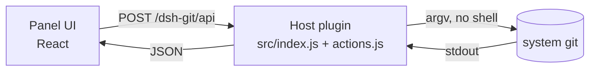

- **Host**: one JSON route `/dsh-git/api` → action table (`src/actions.js`) → `ctx.subprocess` runs `git`. `src/git.js` is a plain engine with an injectable `exec`, free of DSH types.
- **Client**: `sidebarRightTabs` declares three tab types (panel, file diff, commit diff); slots provide bodies and chips. State is a module-level store, so switching the main panel doesn't forget the repository.
- **Data flow**: every action is "read git → return JSON → re-render"; there is no cached state, `status` is the source of truth.
- Why it is built this way (and how it maps to Cursor / VS Code) is in [docs/design.md](docs/design.md).

### Layout

```
src/
  index.js          Host: route, same-origin checks, subprocess
  actions.js        Action table: action → argv / GitHub REST
  git.js            Git engine (injectable exec)
  client/
    00-util.js      React, host calls, formatting, bridges
    10-store.js     Panel state and operations
    15-diff.js      Diff parsing (gutters, pairing)
    16-graph.js     Branch lanes
    17-commit-diff.js Commit-diff cache (repo#sha)
    20-icons.js     Icons
    30-style.js     CSS
    40-panel.js     Panel UI
    45-diff-panel.js File diff tab
    46-hover.js     Hover cards
    47-commit-panel.js Commit diff tab
    50-plugin.js    Dictionaries + tab registration
scripts/            build / verify / render-test
docs/               design.md, worktrees.md, commit-diff.md, reviews/
```

### Verification

```bash
npm run build        # src/ → lib/ (lib is checked in)
npm run verify       # 143 checks: engine, actions, HTTP guards against real git
npm run test:render  # 175 checks: jsdom + real React rendering
```

### Security boundaries

- `/dsh-git/api` accepts `content-type: application/json` only (which forces a preflight), plus a same-origin check and, when available, `connection.requestRejection`.
- The request `path` must live inside a registered workspace (or a subdirectory), otherwise 403.
- File arguments are always `:(literal)` pathspecs; `commitDiff` accepts only a 4–64 hex sha and passes `--no-ext-diff`.
- The GitHub token lives in localStorage; pushing uses your own git credentials.

### Known limits

- No file watching: the panel polls `status` every 8 seconds while visible, plus on focus.
- No conflict resolver (it marks, resolves and aborts merges only).
- The first `status --untracked-files=all` on a huge repo is slow; output is capped at 6 MB.
- Commit diffs are hunk-only, no word-level diff; 60 files per commit.
- Host-side changes (`src/index.js`, `actions.js`, `git.js`) need a **full restart**; client-side ones only need `Ctrl+R`.

---

## Install (local development build)

1. `npm install`
2. `npm run build`
3. In your DSH profile's `cordis.patch.yml`, append:

   ```yaml
   - insert:
       - id: git-management
         name: dsh-git-management
   ```

4. Link the profile's `node_modules`: `mklink /J node_modules\dsh-git-management <this folder>`
5. Restart DSH Desktop.

---

## Docs

- [docs/design.md](docs/design.md) — why system `git`, and the Cursor / VS Code comparison
- [docs/worktrees.md](docs/worktrees.md) — worktree design and trade-offs (Chinese)
- [docs/commit-diff.md](docs/commit-diff.md) — commit-diff tab design and trade-offs (Chinese)
- [docs/reviews/](docs/reviews/) — five expert reviews and a cross-review (Chinese)

## License

MIT
