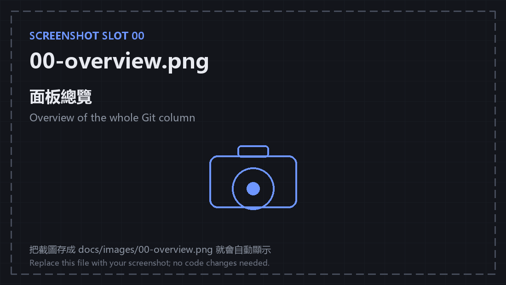
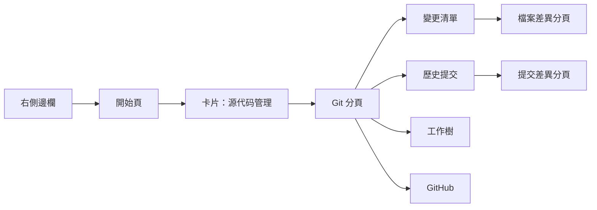
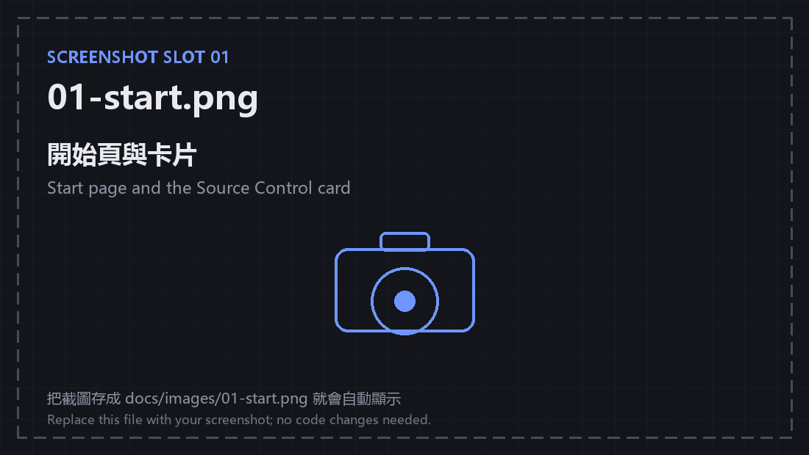
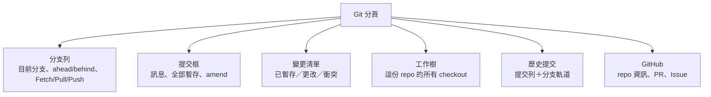
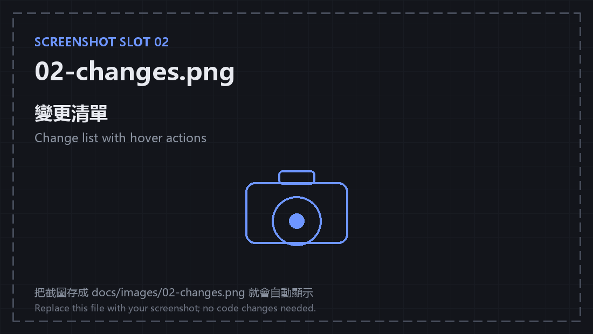
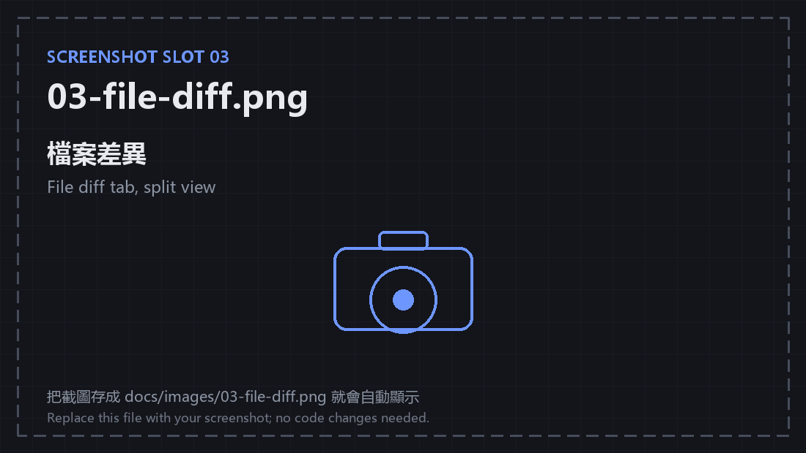
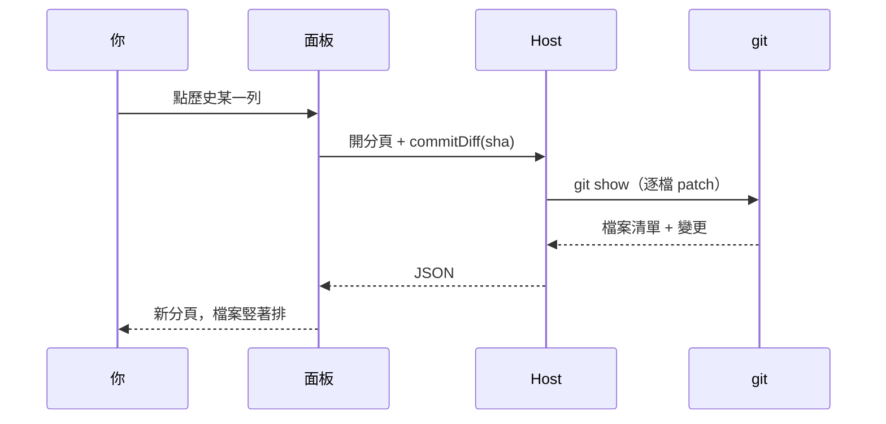
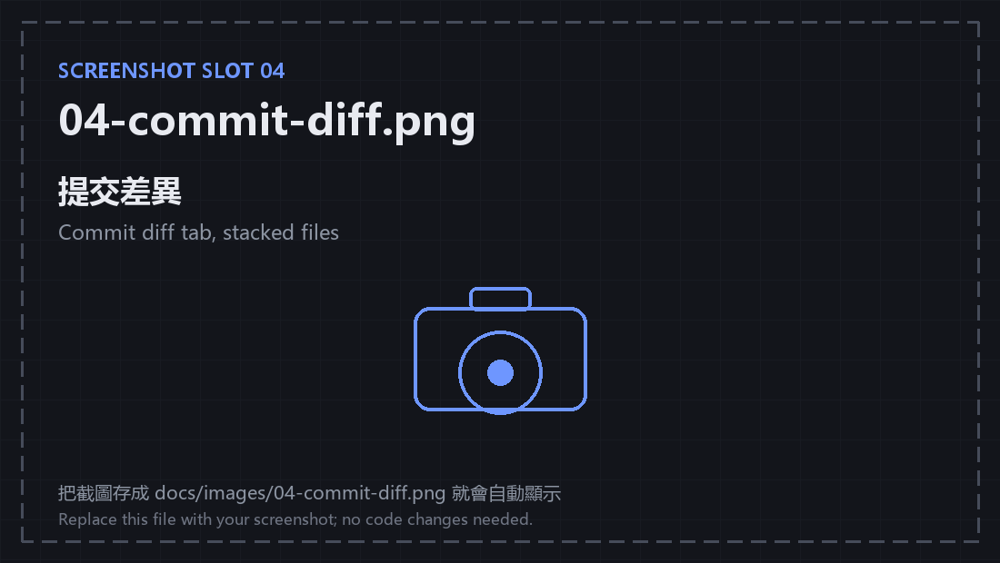
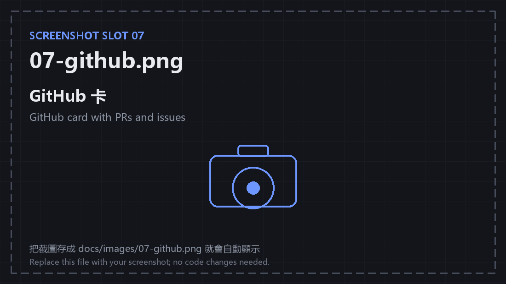
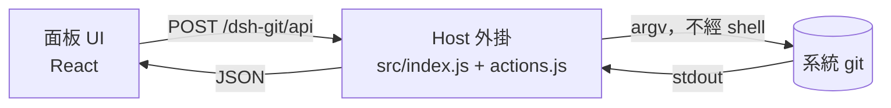

# dsh-git-management

[English](README.en.md) | **繁體中文** | [简体中文](README.zh-CN.md)

**在 DSH 右側邊欄直接管 Git**：暫存、提交、切分支、同步、看歷史、開 PR，全程不用離開對話。

> 這份說明是寫給 **vibe coder** 的：不用背 git 指令，照著「常見情境」點就好。
> 想先看它長怎樣，往下滑到截圖位置（圖片待補，位置已留好）。



> 📸 **截圖位置 00**：整個右側 Git 分欄。怎麼截見文末〈截圖清單〉。

---

## 這是什麼？

- **一個 DSH 外掛**：在右側邊欄多一個「源代码管理」分頁，長得像 Cursor／VS Code 的 Source Control。
- **背後就是系統的 `git`**：跟你在終端打 `git status` 看到的完全一樣。沒有內嵌 Git、沒有神祕狀態，面板和終端永遠對得上。
- **面板只是入口**：檔案差異、整筆提交的差異、工作樹、GitHub PR，都在同一個欄裡開分頁，對話不會被蓋掉。



---

## 30 秒上手

1. 先開一個 **session**（右側邊欄是 session 範圍的，沒有 session 看不到）。
2. 右側欄切到「**開始**」，往下找到第三張卡片「**源代码管理**」。
3. 點它 → 右欄多一個 Git 分頁，預設會選好目前 workspace 的 repo。



> 📸 **截圖位置 01**：右欄「開始」頁，第三張卡片要完整入鏡。

沒看到面板？直接跳〈卡住了？〉。

---

## 介面地圖



| 區塊 | 一句話 |
| --- | --- |
| 分支列 | 你現在在哪、離遠端多遠、一鍵同步 |
| 提交框 | 寫訊息、按提交 |
| 變更清單 | 哪些檔案改了；點檔案看差異 |
| 工作樹 | 同一個 repo 的多個資料夾（讓 Agent 平行工作） |
| 歷史提交 | 過去發生什麼；點一列看那次改了什麼 |
| GitHub | 不用開瀏覽器就能看 PR／Issue、開 PR |

---

## 你可以做什麼

### 提交（最常用）

- 在「更改」清單 hover 檔案 → `＋` 暫存、`↺` 放棄、`🗑` 刪除未追蹤檔。
- 寫提交訊息 → `Ctrl+Enter` 或按「提交」。
- 「全部暫存」一次收進所有變更；勾「修改上次提交」可 amend（訊息會先幫你帶入）。
- 有衝突時提交鍵會停用，並直接告訴你為什麼。



> 📸 **截圖位置 02**：變更清單，hover 某一列讓動作按鈕出現。

### 看差異

- 點檔案 → 右欄開「**檔案差異**」分頁：雙欄行號、統一／並排、上一個／下一個檔案、`Esc` 關閉。
- 分頁標頭直接有「暫存」「放棄」——review 完不用回到清單。
- 衝突檔會直接說「有未解決的衝突」，不會畫錯行號。



> 📸 **截圖位置 03**：檔案差異分頁，切到「並排」。

### 看某一次提交改了什麼

- 歷史任一列點下去 → 右欄開一個新的「**提交差異**」分頁。
- 每個檔案一個區塊、**竪著排**；只畫有變更的 hunk（不載入全文）。
- 改名會顯示 `← 舊路徑`；二進位檔標「二進位」；merge 依第一父提交畫。
- 每次點擊都是**獨立分頁**，兩個提交可以並排看。





> 📸 **截圖位置 04**：提交差異分頁，挑一筆動 2–4 個檔案的提交。

### 歷史與分支軌道

- 左邊是提交列（主旨＋ref 徽章），右邊是 SVG 分支軌道：merge 是彎出去的邊，所有分支都在同一張圖。
- ref 徽章用顏色＋圖示區分「目前檢出／其他本機分支／遠端／標籤」。
- hover 提交可看 sha、作者、時間、內文、`N 個檔案 +X −Y`。
- 預設顯示 10 筆，可展開到 40 筆。


> 📸 **截圖位置 05**：歷史卡，最好拍到有 merge 的 repo。

### 工作樹（讓 Agent 平行工作）

- 列出這份 repo 的所有 checkout，包括 DSH 自己建的 `.agents/worktrees/*`。
- 每列顯示分支、路徑、髒污計數、`主` 標記；可切換面板、開成 DSH 工作區、移除或 prune。


> 📸 **截圖位置 06**：工作樹區塊，至少要有主工作樹＋一個 worktree。

### GitHub

- 自動認出 origin（ssh／https、GitHub Enterprise 也行）。
- 看星標／復刻／issue 數、PR 清單、Issue 清單，從目前分支一鍵開 PR。
- Token 只存在這個瀏覽器；推送走你本機的 git 憑證。



> 📸 **截圖位置 07**：GitHub 卡（先連好 token）。

### 其他小東西

- 多 workspace 下拉切換（會記住上次選的）。
- 不是 git repo 的資料夾可以一鍵 `git init`。
- 背景每 8 秒只讀 `status`，不會洗掉你剛看到的錯誤。
- 錯誤與成功提示 sticky 在頂端，捲動也看得到。

---

## 常見情境（照著做）

### 1. 我改完程式，想提交

1. 右欄「源代码管理」→「更改」清單。
2. 檔案 hover → `＋` 暫存（或直接按「全部暫存」）。
3. 寫訊息 → 提交。
4. 要推上去 → 分支列「Push」（第一次會自動設 upstream）。


### 2. 我想看某次提交改了什麼

1. 往下滑到「歷史提交」。
2. 點那一列 → 右欄開「提交差異」。
3. 檔案多時可用檔頭折疊，或按「收合全部」。

### 3. 我想切分支／同步

1. 點分支列的分支名稱 → 選單選分支。
2. `Fetch` 看遠端有沒有新東西；`Pull` 只做快進合併；`Push` 推出去。
3. `↑2 ↓1` 代表本機領先 2、落後 1。

### 4. 我想讓 Agent 平行工作（worktree）

1. 「工作樹」區塊按 `＋`，輸入名字（例如 `fix-ui`）。
2. 它會建立在 `.agents/worktrees/fix-ui`、分支 `worktree-fix-ui`。
3. 按「開啟」把它開成另一個 DSH 工作區；Agent 在那邊改，主工作區不受影響。

### 5. 我想開 PR

1. 先把分支 Push。
2. 到「GitHub」卡按「新建 PR」→ 填標題／說明／目標分支。
3. 或按「在 GitHub 打開」用網頁操作。

---

## 截圖清單（給你上傳用）

把截圖存到 `docs/images/`，檔名照下表；README 已經接好，**不用改程式**。
圖片建議：深色主題、寬度 800–1200px、PNG。截圖前記得遮掉 token、私人 repo 名稱等不想公開的內容。

| 檔名 | 在哪裡截 | 畫面要包含 | 小提示 |
| --- | --- | --- | --- |
| `00-overview.png` | 開著 Git 分頁的整個右欄 | 分支列、提交框、變更清單、歷史 | 欄寬 360–420px |
| `01-start.png` | 右欄「開始」頁 | 第三張卡片「源代码管理」＋上下兩張卡 | 讓卡片完整入鏡 |
| `02-changes.png` | 變更清單，hover 某一列 | 分組標頭、`+N −N`、hover 動作 | 至少 3 個變更（改 + 新檔） |
| `03-file-diff.png` | 檔案差異分頁，切「並排」 | 雙欄行號、紅綠底、標頭按鈕 | 挑一個真的有增刪的檔 |
| `04-commit-diff.png` | 提交差異分頁 | 2–4 個檔案區塊、檔頭、hunk | 有改名或二進位更好 |
| `05-history.png` | 歷史卡 | 提交列、ref 徽章、分支軌道 | 有 merge 的 repo 最漂亮 |
| `06-worktree.png` | 工作樹區塊 | 主工作樹＋至少一個 worktree、`主` 標記 | 可先建一個 demo worktree |
| `07-github.png` | GitHub 卡 | repo 名、星標、PR／Issue 清單 | 先把 token 連好 |

---

## 卡住了？

| 症狀 | 原因 | 解法 |
| --- | --- | --- |
| 右欄沒有「源代码管理」卡片 | 沒開 session，或外掛還沒載入 | 先開一個 session；`Ctrl+R` 重載頁面 |
| 顯示 `unknown action: commitDiff` | 頁面是新版、**Host 還是舊的 process** | 從選單／托盤「完全結束」DSH Desktop 再開（`Ctrl+R` 不夠） |
| 改了程式碼但面板沒變 | 面板每 8 秒只讀 `status` | 按一下重新整理，或切回視窗觸發刷新 |
| 看不到某個分支的提交 | 歷史只讀本機已有的 ref | 先 `Fetch` |
| 推送失敗 | 本機 git 憑證沒設定 | 在終端 `git push` 一次，讓 Credential Manager 記住 |
| 面板空白／壞掉 | client bundle 沒 build 或壞了 | `npm run build` 後 `Ctrl+R` |

---

## 名詞小抄（給不熟 git 的人）

| 名詞 | 白話 |
| --- | --- |
| 工作區 | 你正在編輯的檔案 |
| 暫存（stage） | 把這次要提交的改動先圈起來 |
| 提交（commit） | 把圈起來的改動存成一個歷史點 |
| 分支（branch） | 一條獨立的開發線 |
| Fetch | 問遠端「有沒有新東西」，先不下載合併 |
| Pull | 把遠端新東西拉下來（只做快進） |
| Push | 把本機提交推上遠端 |
| Worktree | 同一個 repo 的另一個資料夾，可同時開不同分支 |
| Hunk | diff 裡一段連續的變更 |

---

## 給開發者

### 架構



- **Host**：`/dsh-git/api` 一條 JSON 路由 → 動作表（`src/actions.js`）→ `ctx.subprocess` 跑 `git`；`src/git.js` 是可注入 exec 的純引擎，沒有 DSH 依賴。
- **Client**：`sidebarRightTabs` 宣告三種分頁（面板、檔案差異、提交差異），slot 提供內容與晶片；面板狀態是 module-level store，切換主欄不會忘。
- **資料流**：每個動作都是「讀 git → 回 JSON → 重畫」；沒有快取狀態，`status` 是唯一真相。
- 為什麼是這個做法（跟 Cursor／VS Code 的對照）見 [docs/design.md](docs/design.md)。

### 檔案結構

```
src/
  index.js          Host：/dsh-git/api 路由、同源檢查、subprocess
  actions.js        動作表：action → argv／GitHub REST
  git.js            Git 引擎（可注入 exec）
  client/
    00-util.js      React、host 呼叫、格式化、橋接
    10-store.js     面板狀態與操作
    15-diff.js      diff 解析（行號、並排）
    16-graph.js     分支軌道
    17-commit-diff.js 提交差異資料（repo#sha 快取）
    20-icons.js     圖示
    30-style.js     CSS
    40-panel.js     面板 UI
    45-diff-panel.js 檔案差異分頁
    46-hover.js     hover 卡
    47-commit-panel.js 提交差異分頁
    50-plugin.js    字典＋分頁註冊
scripts/            build / verify / render-test
docs/               design.md、worktrees.md、commit-diff.md、reviews/
```

### 驗證

```bash
npm run build        # src/ → lib/（lib 是入庫的產物）
npm run verify       # 143 項：對真的 git 驗引擎、動作、HTTP 守衛
npm run test:render  # 175 項：jsdom + 真的 React 渲染面板
```

### 安全邊界

- `/dsh-git/api` 只吃 `content-type: application/json`（強制 preflight），加同源檢查；有 `connection` 服務時再請它拒絕一次。
- 請求的 `path` 必須在已註冊 workspace 內（或子目錄），否則 403。
- 檔案一律用 `:(literal)` pathspec；`commitDiff` 只接受 4–64 位 hex sha，並加 `--no-ext-diff`。
- GitHub token 只存 localStorage；推送走本機 git 憑證。

### 已知邊界

- 沒有檔案監看：可見時每 8 秒輪詢 `status`，focus 時刷新。
- 不做衝突解決器（只標示、標記解決、中止合併）。
- 大 repo 第一次 `status --untracked-files=all` 會慢；輸出上限 6 MB。
- 提交差異只畫 hunk、不做字元級 diff；單筆上限 60 檔。
- 改了 Host 半（`src/index.js`、`actions.js`、`git.js`）要**完全重啟** DSH Desktop；只改 client 可 `Ctrl+R`。

---

## 安裝（本地開發版）

1. `npm install`
2. `npm run build`
3. 在 DSH profile 的 `cordis.patch.yml` 末尾加：

   ```yaml
   - insert:
       - id: git-management
         name: dsh-git-management
   ```

4. 在 profile 的 `node_modules` 建立連結：`mklink /J node_modules\dsh-git-management <這個資料夾>`
5. 重啟 DSH Desktop。

---

## 文件

- [docs/design.md](docs/design.md) — 為什麼用系統 `git`、跟 Cursor／VS Code 的對照
- [docs/worktrees.md](docs/worktrees.md) — 工作樹功能的設計與取捨
- [docs/commit-diff.md](docs/commit-diff.md) — 提交差異分頁的設計與取捨
- [docs/reviews/](docs/reviews/) — 五份專家評審與交叉評審

## 授權

MIT
