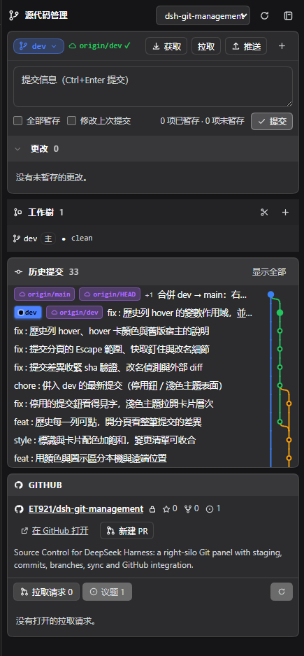
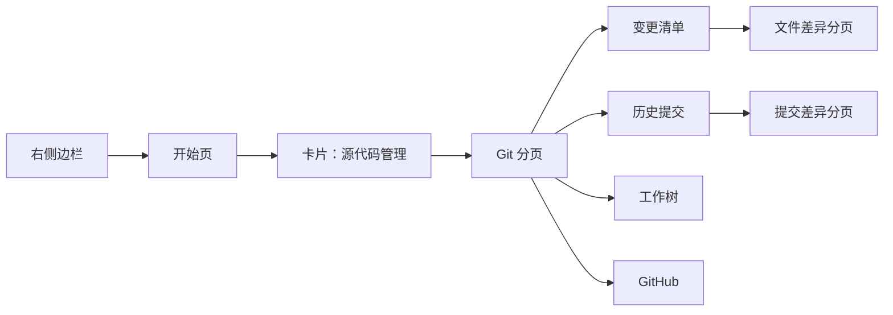
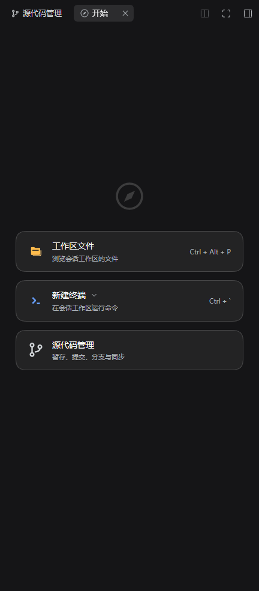
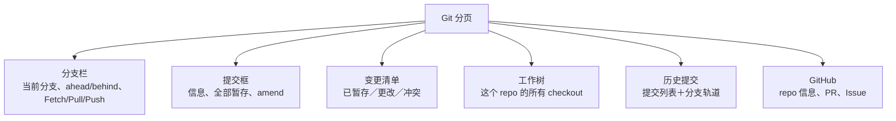
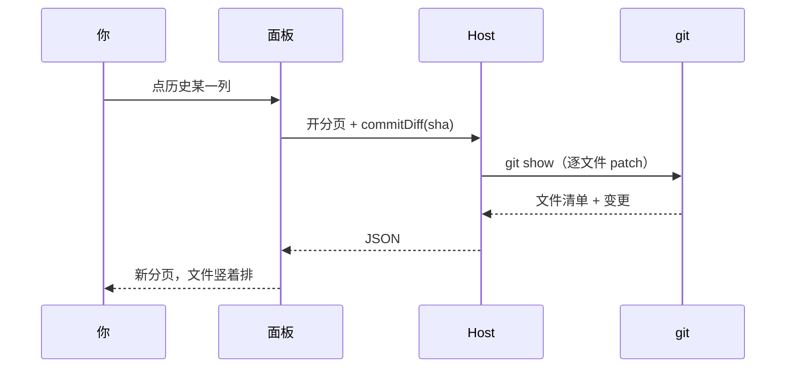
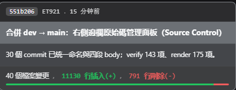
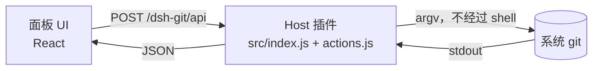

# dsh-git-management

[English](README.en.md) | [繁體中文](README.md) | **简体中文**

**在 DSH 右侧边栏直接管 Git**：暂存、提交、切分支、同步、看历史、开 PR，全程不用离开对话。

> 这份说明是写给 **vibe coder** 的：不用背 git 命令，照着「常见情境」点就好。
> 想先看它长什么样？往下滑，下面有实际截图。



> 整个右侧 Git 分栏：分支栏、提交框、变更清单、历史、GitHub。

---

## 这是什么？

- **一个 DSH 插件**：在右侧边栏多一个「源代码管理」分页，长得像 Cursor / VS Code 的 Source Control。
- **背后就是系统的 `git`**：跟你在终端敲 `git status` 看到的完全一样。没有内嵌 Git、没有神秘状态，面板和终端永远对得上。
- **面板只是入口**：文件差异、整笔提交的差异、工作树、GitHub PR，都在同一个栏里开分页，对话不会被盖掉。



---

## 30 秒上手

1. 先开一个 **session**（右侧边栏是 session 范围的，没有 session 看不到）。
2. 右侧栏切到「**开始**」，往下找到第三张卡片「**源代码管理**」。
3. 点它 → 右栏多一个 Git 分页，默认会选好当前 workspace 的 repo。



> 右栏「开始」页：第三张卡片就是「源代码管理」。

没看到面板？直接跳〈卡住了？〉。

---

## 界面地图



| 区块 | 一句话 |
| --- | --- |
| 分支栏 | 你现在在哪、离远端多远、一键同步 |
| 提交框 | 写信息、按提交 |
| 变更清单 | 哪些文件改了；点文件看差异 |
| 工作树 | 同一个 repo 的多个文件夹（让 Agent 并行工作） |
| 历史提交 | 过去发生了什么；点一列看那次改了什么 |
| GitHub | 不用开浏览器就能看 PR / Issue、开 PR |

---

## 你可以做什么

### 提交（最常用）

- 在「更改」清单 hover 文件 → `＋` 暂存、`↺` 放弃、`🗑` 删除未跟踪文件。
- 写提交信息 → `Ctrl+Enter` 或按「提交」。
- 「全部暂存」一次收进所有变更；勾「修改上次提交」可 amend（信息会先帮你带入）。
- 有冲突时提交按钮会停用，并直接告诉你为什么。

### 看差异

- 点文件 → 右栏开「**文件差异**」分页：双栏行号、统一／并排、上一个／下一个文件、`Esc` 关闭。
- 分页标题栏直接有「暂存」「放弃」——review 完不用回到清单。
- 冲突文件会直接说「有未解决的冲突」，不会画错行号。

### 看某一次提交改了什么

- 历史任意一列点下去 → 右栏开一个新的「**提交差异**」分页。
- 每个文件一个区块、**竖着排**；只画有变更的 hunk（不加载全文）。
- 改名会显示 `← 旧路径`；二进制文件标「二进制」；merge 按第一父提交画。
- 每次点击都是**独立分页**，两个提交可以并排看。




> 点历史一列开的提交分页：每个文件一个区块，只画有变更的 hunk。

### 历史与分支轨道

- 左边是提交列表（主旨＋ref 徽章），右边是 SVG 分支轨道：merge 是弯出去的边，主线固定在同一栏，分支只在右侧开。
- 默认只走**当前分支**这条线，和 Cursor 一样；要连其他分支一起看，按历史标题栏的「当前分支／全部分支」。
- ref 徽章只标**当前检出、它的已发布副本、默认分支与标签**。指向同一提交的其他分支不挂徽章，它们在 hover 卡与分支下拉里。
- hover 提交可看 sha、作者、时间、正文、`N 个文件 +X −Y`。
- 默认显示 10 条，可展开到 40 条。



> 滑过历史列的 hover 卡：sha、作者、时间、正文与 `N 个文件 +X −Y`。

### 工作树（让 Agent 并行工作）

- 列出这个 repo 的所有 checkout，包括 DSH 自己建的 `.agents/worktrees/*`。
- 每列显示分支、路径、脏文件计数、`主` 标记；可切换面板、开成 DSH 工作区、移除或 prune。

### GitHub

- 自动认出 origin（ssh / https、GitHub Enterprise 也行）。
- 看星标／复刻／issue 数、PR 清单、Issue 清单，从当前分支一键开 PR。
- Token 只存在这个浏览器；推送走你本机的 git 凭证。

### 其他小东西

- 多 workspace 下拉切换（会记住上次选的）。
- 不是 git repo 的文件夹可以一键 `git init`。
- 后台每 8 秒只读 `status`，不会冲掉你刚看到的错误。
- 错误与成功提示 sticky 在顶部，滚动也看得到。

---

## 常见情境（照着做）

### 1. 我改完代码，想提交

1. 右栏「源代码管理」→「更改」清单。
2. 文件 hover → `＋` 暂存（或直接按「全部暂存」）。
3. 写信息 → 提交。
4. 要推上去 → 分支栏「Push」（第一次会自动设 upstream）。


### 2. 我想看某次提交改了什么

1. 往下滑到「历史提交」。
2. 点那一列 → 右栏开「提交差异」。
3. 文件多时可用文件头折叠，或按「全部折叠」。

### 3. 我想切分支／同步

1. 点分支栏的分支名 → 菜单选分支。
2. `Fetch` 看远端有没有新东西；`Pull` 只做快进合并；`Push` 推出去。
3. `↑2 ↓1` 代表本地领先 2、落后 1。

### 4. 我想让 Agent 并行工作（worktree）

1. 「工作树」区块按 `＋`，输入名字（例如 `fix-ui`）。
2. 它会创建在 `.agents/worktrees/fix-ui`、分支 `worktree-fix-ui`。
3. 按「打开」把它开成另一个 DSH 工作区；Agent 在那边改，主工作区不受影响。

### 5. 我想开 PR

1. 先把分支 Push。
2. 到「GitHub」卡按「新建 PR」→ 填标题／说明／目标分支。
3. 或按「在 GitHub 打开」用网页操作。

---

## 截图清单

目前放了四张实际截图。要换图时，直接覆盖 `docs/images/` 里同名的文件即可，**不用改代码**。
截图建议：深色主题、PNG；上传前记得遮掉 token、私人 repo 名称等不想公开的内容。

| 文件 | 画面 |
| --- | --- |
| `00-overview.png` | 整个右侧 Git 分栏（分支栏、提交框、变更清单、历史、GitHub） |
| `01-start.png` | 右栏「开始」页与「源代码管理」卡片 |
| `04-commit-diff.png` | 提交差异分页（多文件竖排） |
| `05-hover.png` | 提交 hover 卡（sha、作者、时间、正文、统计） |

---

## 卡住了？

| 症状 | 原因 | 解法 |
| --- | --- | --- |
| 右栏没有「源代码管理」卡片 | 没开 session，或插件还没加载 | 先开一个 session；`Ctrl+R` 重载页面 |
| 显示 `unknown action: commitDiff` | 页面是新版、**Host 还是旧的 process** | 从菜单／托盘「完全退出」DSH Desktop 再开（`Ctrl+R` 不够） |
| 改了代码但面板没变 | 面板每 8 秒只读 `status` | 按一下刷新，或切回窗口触发刷新 |
| 看不到某个分支的提交 | 历史只读本地已有的 ref | 先 `Fetch` |
| 推送失败 | 本机 git 凭证没设置 | 在终端 `git push` 一次，让 Credential Manager 记住 |
| 面板空白／坏掉 | client bundle 没 build 或坏了 | `npm run build` 后 `Ctrl+R` |

---

## 名词小抄（给不熟 git 的人）

| 名词 | 大白话 |
| --- | --- |
| 工作区 | 你正在编辑的文件 |
| 暂存（stage） | 把这次要提交的改动先圈起来 |
| 提交（commit） | 把圈起来的改动存成一个历史点 |
| 分支（branch） | 一条独立的开发线 |
| Fetch | 问远端「有没有新东西」，先不下载合并 |
| Pull | 把远端新东西拉下来（只做快进） |
| Push | 把本地提交推上远端 |
| Worktree | 同一个 repo 的另一个文件夹，可同时开不同分支 |
| Hunk | diff 里一段连续的变更 |

---

## 给开发者

### 架构



- **Host**：`/dsh-git/api` 一条 JSON 路由 → 动作表（`src/actions.js`）→ `ctx.subprocess` 跑 `git`；`src/git.js` 是可注入 exec 的纯引擎，没有 DSH 依赖。
- **Client**：`sidebarRightTabs` 声明三种分页（面板、文件差异、提交差异），slot 提供内容与标题；面板状态是 module-level store，切换主栏不会忘。
- **数据流**：每个动作都是「读 git → 回 JSON → 重画」；没有缓存状态，`status` 是唯一真相。
- 为什么是这种做法（跟 Cursor / VS Code 的对照）见 [docs/design.md](docs/design.md)。

### 文件结构

```
src/
  index.js          Host：/dsh-git/api 路由、同源检查、subprocess
  actions.js        动作表：action → argv / GitHub REST
  git.js            Git 引擎（可注入 exec）
  client/
    00-util.js      React、host 调用、格式化、桥接
    10-store.js     面板状态与操作
    15-diff.js      diff 解析（行号、并排）
    16-graph.js     分支轨道
    17-commit-diff.js 提交差异数据（repo#sha 缓存）
    20-icons.js     图标
    30-style.js     CSS
    40-panel.js     面板 UI
    45-diff-panel.js 文件差异分页
    46-hover.js     hover 卡
    47-commit-panel.js 提交差异分页
    50-plugin.js    字典＋分页注册
scripts/            build / verify / render-test
docs/               design.md、worktrees.md、commit-diff.md、reviews/
```

### 验证

```bash
npm run build        # src/ → lib/（lib 是入库的产物）
npm run verify       # 147 项：对真的 git 验证引擎、动作、HTTP 守卫
npm run test:render  # 177 项：jsdom + 真的 React 渲染面板
```

### 安全边界

- `/dsh-git/api` 只吃 `content-type: application/json`（强制 preflight），加同源检查；有 `connection` 服务时再请它拒绝一次。
- 请求的 `path` 必须在已注册 workspace 内（或子目录），否则 403。
- 文件一律用 `:(literal)` pathspec；`commitDiff` 只接受 4–64 位 hex sha，并加 `--no-ext-diff`。
- GitHub token 只存 localStorage；推送走本机 git 凭据。

### 已知边界

- 没有文件监听：可见时每 8 秒轮询 `status`，focus 时刷新。
- 不做冲突解决器（只标示、标记解决、中止合并）。
- 大 repo 第一次 `status --untracked-files=all` 会慢；输出上限 6 MB。
- 提交差异只画 hunk、不做字符级 diff；单笔上限 60 个文件。
- 改了 Host 半（`src/index.js`、`actions.js`、`git.js`）要**完全重启** DSH Desktop；只改 client 可 `Ctrl+R`。

---

## 安装（本地开发版）

1. `npm install`
2. `npm run build`
3. 在 DSH profile 的 `cordis.patch.yml` 末尾加：

   ```yaml
   - insert:
       - id: git-management
         name: dsh-git-management
   ```

4. 在 profile 的 `node_modules` 建链接：`mklink /J node_modules\dsh-git-management <这个文件夹>`
5. 重启 DSH Desktop。

---

## 文档

- [docs/design.md](docs/design.md) — 为什么用系统 `git`、跟 Cursor / VS Code 的对照
- [docs/worktrees.md](docs/worktrees.md) — 工作树功能的设计与取舍
- [docs/commit-diff.md](docs/commit-diff.md) — 提交差异分页的设计与取舍
- [docs/reviews/](docs/reviews/) — 五份专家评审与交叉评审

## 许可证

MIT
